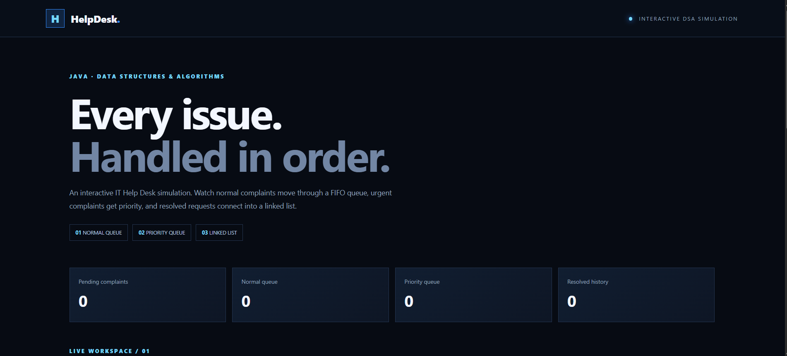
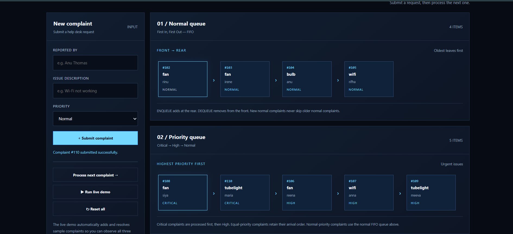
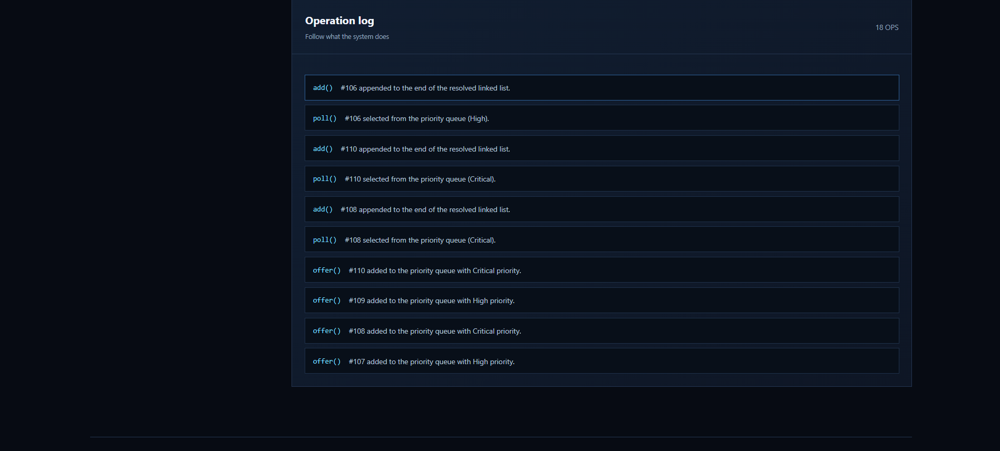
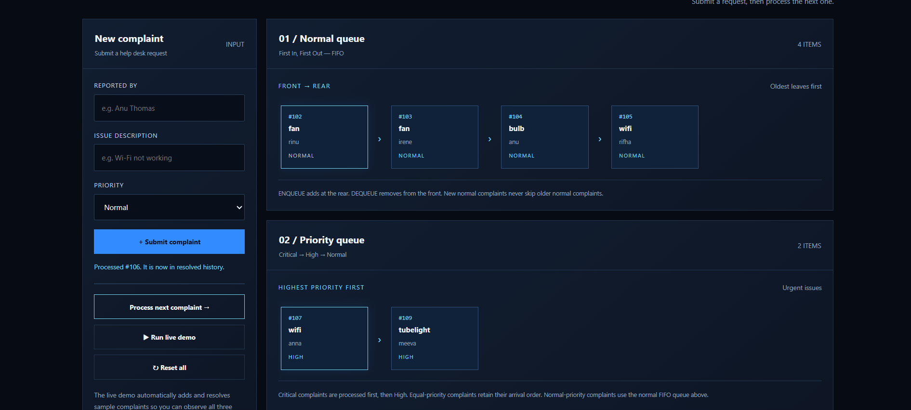
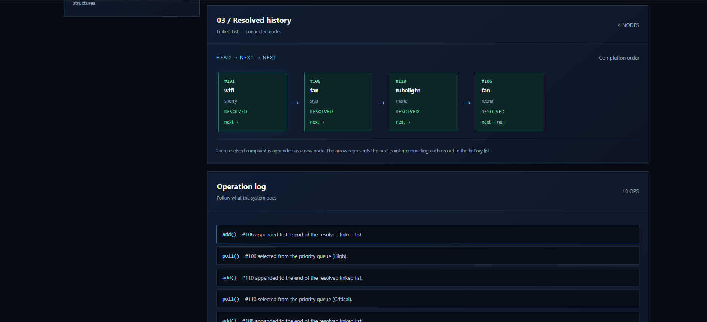

# IT Help Desk Management System

A Java-based Data Structures and Algorithms project that organizes technical support complaints using Queue, Priority Queue, and Linked List.

## Project Details

- **Project:** IT Help Desk Management System
- **Student:** Sherry James
- **Roll Number:** 56
- **Department:** Computer Science and Engineering
- **College:** Amal Jyothi College of Engineering

## Features

- Register technical support complaints.
- Process normal complaints in FIFO order.
- Handle urgent complaints using priority-based processing.
- Store resolved complaints in a linked list.
- Search and view complaint history in the interactive website demo.

## Data Structures Used

### 1. Queue
Stores normal complaints in First In, First Out (FIFO) order.

### 2. Priority Queue
Processes Critical complaints before High-priority complaints. Complaints with equal priority retain their arrival order.

### 3. Linked List
Maintains a history of resolved complaints.

## Technologies Used

- Java
- HTML
- CSS
- JavaScript
- Visual Studio Code

## Project Structure

```text
IT Help Desk/
├── src/
│   └── Main.java
├── web/
│   └── index.html
├── README.md
└── .gitignore
```

## How to Run

### Java application

Open a terminal in the project folder and run:

```bash
javac src/Main.java
java -cp src Main
```

### Website demo

Open `web/index.html` in a web browser.

The website is a browser-based demonstration of the help desk workflow. It currently runs separately from the Java application.

## Screenshots

Screenshots of the application and website will be added here.

## Purpose

This project demonstrates how fundamental data structures can be applied to complaint management, priority-based processing, and maintaining a record of resolved issues.
## Screenshots

Screenshots of the application and website will be added here.

## Screenshots

### Homepage


### Linked List


### Queue Processing


### Working Demo


### Additional Demo


